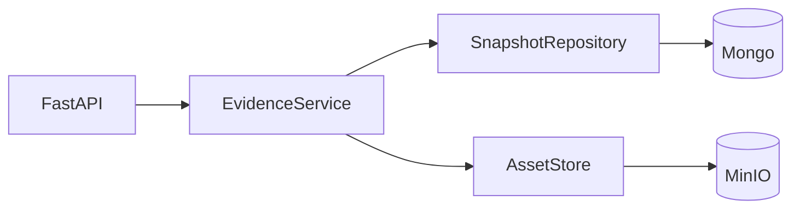

# ADR-003 · Evidence 最小读取优化

状态：Accepted，范围收口于最小读取切片（2026-11-07）。实施与验证以 [ACCEPTANCE](../ACCEPTANCE.md) 为准，不以本页代替交付证据。

**Evidence 是不可变执行证据的唯一事实入口，不是整个 EvoNext 的数据访问中台。DAL 只解决读取、写入、身份、完整性和存储错误；审核、评估、训练、恢复等业务判断由各自领域负责。优化优先针对已验证的访问路径，不因潜在需求引入额外持久化、抽象或后台任务。**

本决策细化 [03 架构](../rebuild/03_ARCHITECTURE.md)，保留 Mongo/MinIO/PG 与 OpenCUA 合同；[COMPATIBILITY](../COMPATIBILITY.md) 仍是唯一兼容合同，[ROADMAP](../ROADMAP.md) 仍管理交付顺位。

## 1. 调查依据和基线

旧版只读调查涉及任务/版本读取、资产引用/策略及冲突、缓存回归。值得保留的是：固定版本（含 0）、原始证据与查询投影分离、CAS、授权先于缓存、借用客户端不误关。审核保存、评估投影、维护任务应留在各自 owner，不汇聚进 Task 大接口。未复制旧私有后端、配置、真实数据或历史档案，也未连接旧服务。

本设计的本地基线是 `main` 的 HEAD `d167282a1025406ae7b587ef4fbe6f4a6a24934d` **加未提交工作树**。前端重构尚未包含在该 commit 中；远端 main/其他分支不能据此推断已存在 EvidenceClient。以下摘要固定本轮开始时的前端观察对象，本切片不修改它们：

| 工作树文件 | SHA-256 |
|---|---|
| `web/src/main.tsx` | `680d60b36feec5ad0578a4b291d889f8c16bc276e3367c9e22c8c79b928c3c46` |
| `web/src/App.tsx` | `9bfdf9a6930dab5d3d25618cdd0ceeb304c25bcfbba367368899af7288f10839` |
| `web/src/evidence/client.ts` | `2688395f0a53470c09013afcf0cf3e8ad6a7e531c8428fdb1fe92c384706d5b4` |
| `web/src/evidence/media.ts` | `2a7de3cd34744bde1a9dd8b0743012f4cfdcfd3ce68ac8d28a5619d4a0b6f663` |

当前本地页面选中轨迹仍立即读取完整 detail，后端图片优化不消除这次传输。远端旧 main 的 main.tsx 和本地 App/EvidenceClient 都须按实际分支核实，不能混作同一代码证据。本页没有声称重新核验了远端。

| 已确认访问路径 | 优化决定 |
|---|---|
| `MongoSnapshots.list()` 已只读 summary | 保留 hash 排序、现役 cursor 和返回形状 |
| `MongoSnapshots.get()` 全量读取并构造 Snapshot | 完整原文路径保留；轻量路径不再经过它 |
| Snapshot 属性反复解析/计算，media 可被外部修改 | 构造时解析、校验和计算一次；公开容器返回隔离副本 |
| 图片 API 先读完整 Snapshot 找 digest | Service 用 snapshot_id + locator 核验绑定后读字节 |
| ready 每次创建 PG Ledger | 每个 app lifespan 复用一个 engine，退出时释放 |

## 2. 首阶段结构和成功标准

仅用 `SnapshotRepository + AssetStore` 两个端口，不独立增加 EvidenceReader、读写 Repository 或通用 BaseRepository。现役 `put/get` 分别承担 accept/get_raw 语义，保留调用路径；只增加确有用途的 `get_index`。

CLI 和 Worker 继续使用各自用例及同一 Evidence 事实端口，不新增调度或控制系统。Import Receipt 不加入此读取主链。

| 操作 | 数据与约束 |
|---|---|
| put / accept | 校验后的冻结 Snapshot；同内容幂等；现役返回 snapshot_id |
| get / get_raw | 原 trajectory/metadata bytes + 媒体 manifest；核对 JSON 与包身份 |
| get_index | 一次 Mongo 字段投影取得同一 wrapper 内的 manifest + header；无额外 get_header/get_manifest 数据库往返 |
| list | summary 投影，snapshot_id 去重，现役 hash 分页 |
| AssetStore.get | digest → 原字节并核验 hash；digest 是内部存储身份，不是访问授权 |

第一阶段的用户操作标准：**列表不加载轨迹，查看概要不加载轨迹，打开图片不加载轨迹**。新格式概要/媒体路径不能查询 trajectory_json/metadata_json，也不能解析轨迹。只有原文、兼容完整 detail、完整包导出、完整性检查以及明确的旧记录回退允许全量读取。字段投影减少返回字段和网络传输，不承诺 Mongo 底层磁盘 I/O 同比例下降。

新增 header API 供后续前端接入，完整 detail/download 保留。PR 1 不宣称当前页面已按需读步骤，或选中轨迹已消除整轨迹成本。

## 3. 轻量 wrapper、身份与完整性

新增快照在原子 Mongo 插入时增加 `index`：profile 为 `evonext.snapshot-index.v1`，包含原 `evonext.snapshot-bytes.v1` manifest 和 header（完整 instruction、summary、missing_media）。该字段可重建，不进入 Snapshot.id，不写进 trajectory/metadata，也不获得审核或评估权威。header 仅核查形状和快照关联，局部读取不能独立证明其语义与原文一致。

旧记录缺 index 时：显式全量读一次，验证原 JSON/身份，生成请求内视图；不在 GET、ready 或启动时修库、建索引或迁移。已有但损坏/未知 profile 的 index 报错，不当成缺字段回退，更不替换为其他版本。首阶段不新增 backfill 工具或后台任务。

Snapshot.media 与其他公开容器的外部修改不得影响原 bytes、缓存视图或身份；解析结果内部复用，公开读取返回副本。完整 BSON 编码（包括 media、summary、index 和字段开销）须不超过 16 MiB；12 MiB 只是现有 JSON 输入上限。校验在发送 Mongo 写入前进行，不把轨迹迁离 Mongo。

| 内部校验维度 | 含义与边界 |
|---|---|
| manifest_binding_checked | manifest 的规范编码 hash 与 snapshot_id 对应；不读取原 JSON/媒体 |
| raw_json_verified | trajectory、metadata 原 bytes 及组合包身份已核对；不等于全部图片已验证 |
| media_verified | 本次实际读到并核对的媒体范围；单图成功不能声明整包媒体已验证 |

不再使用笼统的 full_bytes_verified。三个维度不必全部暴露为 HTTP 字段。SnapshotIndex 的 raw_json_verified 区分轻量读取与旧格式已验 JSON 的回退；媒体由各字节适配器对本次对象校验，完整检查仍逐图读取。

Service 媒体入口必须接受 `(snapshot_id, locator)`；绑定校验完成后才读 digest。API Key 鉴权仍逐次发生，用户提交 digest、任意 URL 或本地路径均不能绕过绑定。现有单 workspace 身份不宣称具备多来源权限、墓碑或撤权体系。

JSON 上传先解析再编码：保证结构/字段/字符串内容，**不保证上传文件的空白和输入 bytes**。已存储 Snapshot 的原 bytes 保持稳定。ZIP 保证当前 profile 的 trajectory.json、metadata.json、媒体成员名称与原内容 bytes；不保证压缩容器本身逐字节相同。两类输入使用不同 oracle 验收。

## 4. Snapshot 与 SourceBinding 的列表语义

Evidence 资产列表以 snapshot_id 去重。未来若加入时间，`snapshot_accepted_at` 表示该字节快照首次被接受的时间；它不是来源接入时间。

来源历史列表以 SourceBinding 为单位，同一 Snapshot 可以有多个 namespace/key/revision；`binding_accepted_at` 表示该来源版本建立绑定的时间。两种记录不共享含混的 accepted_at。来源映射完成并明确分页记录身份前，不增加来源过滤或时间排序；第一阶段保留现役 hash 游标，不为此建索引或 SourceBinding collection。

## 5. 写入的小修正和独立后续范围

成功且已确认的新插入利用 PyMongo UpdateResult 避免再读整份轨迹；已有记录仍全量核对内容，不能只信 summary/index。未确认写入/timeout 不返回成功，不盲目重试，也不能推断从未写入。本切片不提供自动核对恢复、操作状态 API 或新幂等协议。

导入可靠性另立工作包：客户端在上传前持有稳定幂等键（或可重建操作身份），才能在响应丢失后查询同一操作。随后才设计 Import Receipt、SourceBinding 唯一性、Mongo/MinIO/PG 阶段核对、专用 PG schema、保留/清理与隔离故障验收；不修改模型收费回执或 append-only 操作回执的意义。它们不阻塞读取切片。

步骤读取也暂缓，必须区分：

| 路径 | HTTP 返回 | Mongo → 应用的轨迹读取 |
|---|---|---|
| full_read_fallback：全量后 Python 切片 | 可以有界 | 仍然全量；缓存首次读取也如此 |
| indexed_window：独立步骤投影 | 有界 | 可按窗口查询，须独立测量 |

现有 JSON 字符串不能直接 `$slice`。未来若建设 indexed_window，才设计 source hash、position/源 ID 分离、ready manifest 与发布规则；不能把 fallback 的响应有界计入存储读取有界指标。

## 6. 实施顺序和验收

1. **PR 1，当前范围**：Snapshot 解析复用/公开状态隔离、轻量 index、Service 媒体读取、原接口和缺字段回退；顺手复用 ready 的 PG engine。保留官方 BSON 尺寸核验和 confirmed insert 的小优化，不展开完整异常/连接框架。
2. **PR 2**：前端接入轻量 header、按需展示步骤，保留完整 detail/download。记录 50/200/2000 步的数据库返回字节、JSON 解析次数、服务端耗时和首屏延迟；响应切片明确标 full_read_fallback。先测量再定 UI 请求边界。
3. **PR 3，仅在指标证明必要时**：建设步骤投影；分别报告 full_read_fallback/indexed_window 的成本。收益不足则保持简单实现。

导入可靠性、多来源权限、复杂恢复和 GC 均不在这三个读取切片中。拆分为 PR 顺序不等于已创建或已授权发布远端 PR。

| ID | 场景与验收 | 当前所属范围 |
|---|---|---|
| DA-01 | JSON 语义保真；ZIP 独立 bytes oracle；长 ID、版本 0、raw/dispatch/result/未知字段保留 | PR 1 |
| DA-02 | 公共 dict 修改不改变 Snapshot；构造后重复访问不再 JSON 解析/计算身份 | PR 1 |
| DA-03 | 新 index 的 header/media 请求只投影 index，不读正文、不解析轨迹 | PR 1 |
| DA-04 | 缺 index 只读回退；坏 index/坏 raw 拒绝；GET 无迁移写入 | PR 1 |
| DA-05 | list 保留 summary 投影/hash cursor/资产去重，不引入来源时间混义 | PR 1 |
| DA-06 | digest 不能代替 locator 授权；实际读取媒体核验 bytes，坏绑定不换版本 | PR 1 |
| DA-07 | confirmed insert 无全文读回；已有记录核对；完整 BSON 超限在写入前拒绝；timeout 不重试 | PR 1；断连实况另验 |
| DA-08 | ready 复用 PG engine；退出释放 owned 资源，借用客户端不误关 | PR 1；真实池行为另验 |
| DA-09 | 页面接入轻量读取，50/200/2000 步分别记录 full-read 成本和首屏 | PR 2，尚未验 |
| DA-10 | 步骤 indexed_window 真正按窗口读；源 ID 与 position 不混，发布不全不冒充缺证 | 条件 PR 3，暂缓 |

切换只更换内部读入口，增加兼容 header 路由；旧 detail、trajectory、bundle、media 继续可用。新增 wrapper 对旧代码是额外字段，回滚读取路径仍能读取新写入的原证据；不修改旧平台集合或部署。每个切片执行 pytest、compileall、Ruff、前端测试/构建；单元测试中的 collection double 只证明访问路径，不代替真实 Mongo/MinIO/PG、BSON 磁盘 I/O、生产性能或断连恢复验收。
